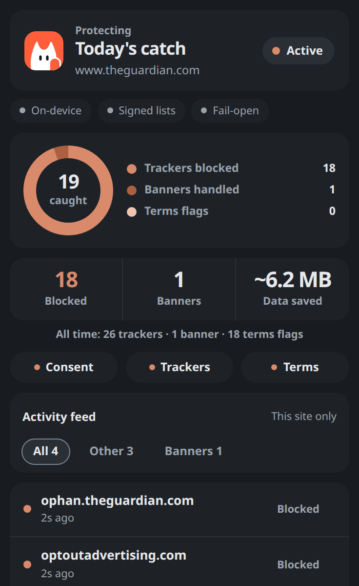
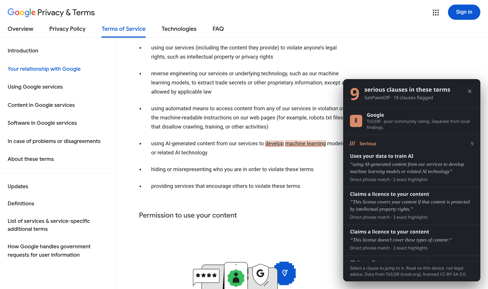
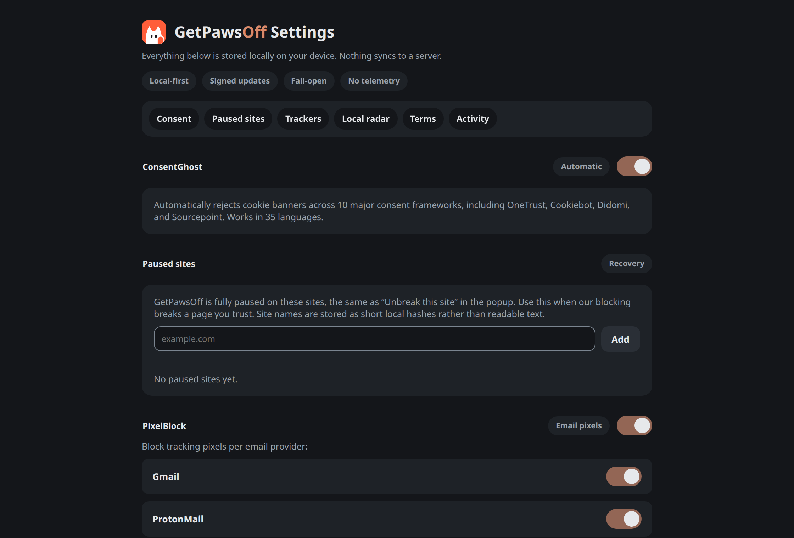

# GetPawsOff

A privacy extension for Chrome that says no on your behalf. It rejects cookie
banners, blocks trackers, strips tracking pixels out of webmail, and reads the
terms of service you were going to skip.

It runs on your device. There is no account, no analytics and no server of
mine that sees what you browse.



## What it does

**Cookie banners.** When a consent banner shows up, the extension rejects it.
It never clicks "Accept". If a site only offers "pay or accept", it leaves the
banner alone and tells you so in the popup.

**Trackers.** A bundled EasyPrivacy ruleset blocks known trackers at the
network level, before the request leaves your browser.

**Tracking pixels in webmail.** Marketing emails carry invisible images that
report when you opened them. The extension blocks those in Gmail, Outlook,
Proton Mail, Yahoo Mail, Zoho Mail, Fastmail, HEY, Tuta and iCloud Mail.

**Terms of service.** On a terms or privacy policy page, a small panel lists
the clauses worth knowing about: selling your data, forced arbitration,
changing the terms without notice, claiming a licence to your content, and
others. Click one and it scrolls to the exact sentence. Where ToS;DR has graded
the service, the grade is shown next to it.



**A tracker learner.** The extension also watches which third parties turn up
across the sites you visit, the way Privacy Badger does. For now it only
observes and reports. It does not block anything by itself yet.

## Install

From the Chrome Web Store: search for GetPawsOff.

From source:

1. Clone this repository.
2. Open `chrome://extensions` and turn on **Developer mode**.
3. Click **Load unpacked** and pick the repository folder.

The paw icon appears in the toolbar. The popup shows what happened on the
current page. The options page has the per-site switches.



## What has and has not been tested

I am one person, and I would rather tell you this than have you find out.

- **Webmail pixel blocking is not fully tested.** I have checked some of the
  supported mail providers myself and it works on those. I can't test all of
  them: each one needs an account, real marketing mail and a changing inbox
  layout. If it misses pixels or breaks something in your provider, please
  open an issue and say which one.
- **Cookie banners are not all handled.** There are hundreds of consent tools
  and sites customise them. Some banners will stay up. Pay-or-accept walls are
  left alone on purpose.
- **The terms scanner reads patterns, not law.** It can miss a clause or flag
  a harmless one. It is a prompt to read the sentence, not legal advice.

If the extension breaks a site, use **Pause on this site** in the popup.

## Privacy

- Everything is stored in `chrome.storage.local` on your device. Nothing is
  uploaded.
- Sites are recorded as a short hash, not a URL. This keeps site names out of
  plain view. It is not encryption: someone with access to your browser
  profile could match the hashes against a list of known sites. Records are
  capped and pruned.
- In incognito windows, blocking still works and nothing is recorded.
- The one network request the extension makes for itself is a rules update
  from `config.getpawsoff.app`. The file is signed, the extension checks the
  signature against a key built into it, and if the check fails it keeps the
  rules it already has. [`docs/CLOUDFLARE_SETUP.md`](docs/CLOUDFLARE_SETUP.md)
  explains the feed and how to host your own.

The full policy is in [`PRIVACY_POLICY.md`](PRIVACY_POLICY.md).

## Permissions

Chrome warns that the extension can "read and change all your data on all
websites". Every content blocker gets that warning. This is what each
permission is used for:

| Permission | Why |
|---|---|
| All sites (`http://*/*`, `https://*/*`) | Banners and trackers appear on any site, so the scripts have to run everywhere. |
| `scripting` | Runs the consent API call inside the page when a banner needs it. |
| `declarativeNetRequest`, `declarativeNetRequestFeedback` | Lets Chrome block trackers from the bundled ruleset and count what it blocked. |
| `webRequest` | Notices when Chrome blocks a request, so the count per tab is right. It does not read request contents. |
| `tabs`, `activeTab` | Shows the count for the current tab on the icon and in the popup. |
| `alarms` | Schedules the hourly check for a rules update. |
| `storage` | Keeps settings and activity on your device. |

## Contributing

Issues and pull requests are open.

The reports that help most:

- A site where a cookie banner was not rejected, or where the extension broke
  the page.
- A webmail provider where pixel blocking fails. See the testing note above.
- A terms page where a clause was flagged wrongly or missed.

For a bug report, open the options page, click **Copy diagnostics** and paste
the result. It contains no site names.

For a pull request:

```
npm test
```

There are no dependencies to install. CI runs the tests on Node 20. Keep a
change to one thing, and add a test when you change behaviour. New permissions
and anything that sends data off the device will be declined.

Security problems go through the private channel in
[`SECURITY.md`](SECURITY.md), not a public issue.

## How it is maintained

- Tests run on every pull request and on every push to `main`.
- The EasyPrivacy rules are rebuilt weekly into a pull request.
- Consent rules follow DuckDuckGo's autoconsent. A weekly job opens a pull
  request to bump the pinned version.
- The signed rule feeds are rebuilt and published daily.
- To release: bump `version` in `manifest.json`, `package.json` and
  `background.js` (a test keeps the three in sync), then push a tag such as
  `v1.0.1`. CI attaches `getpawsoff.zip` to a GitHub release, and that zip is
  uploaded to the Chrome Web Store by hand. `npm run pack` builds the same zip
  locally.

## Licence

The code is under [MPL-2.0](LICENSE). Bundled data from DuckDuckGo autoconsent,
EasyPrivacy and ToS;DR keeps its own licence, listed in
[`THIRD-PARTY-NOTICES.md`](THIRD-PARTY-NOTICES.md).

"GetPawsOff" and the logo are the project's name and branding. Please ask
before reusing them.

## About

A solo side project I work on in my spare time, with some AI pair-programming
along the way to move faster.
